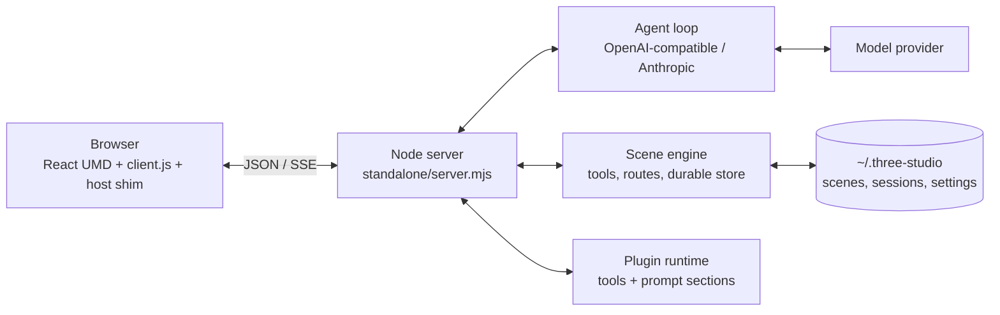

# Three Studio

**An AI-native 3D workbench for Three.js — standalone, local-first, and fully
embedded.**

Three Studio turns a conversation into a live 3D workspace. The AI writes
self-contained Three.js scenes through tools, the preview renders them in a
sandboxed `srcDoc` iframe, and the same surface carries an editor, timeline,
dope sheet, shots, review pins, measurements, assets, history, sessions, model
settings and a plugin market.

The primary deployment runs **without DeepSeek Harness**: its own Node server,
storage, agent loop and React shell. The original host-integrated Harness plugin
remains available as an optional legacy mode.

[English](README.md) · [简体中文](README.zh.md)


## Highlights

- **AI-native studio** — chat, streaming tool calls and scene revisions in the
  same surface as the viewport.
- **Real Three.js editing** — outliner, inspector, material/lighting controls,
  transform gizmos, parameters, timeline, keyframes, dope sheet, shots, review
  pins, measurements and deterministic exports.
- **Many export targets** — PNG, deterministic MP4/GIF/WebM, animated or static
  glTF (`.glb`), STL, OBJ, project ZIP and standalone HTML; USDZ for AR
  previews and a native binary FBX 7.4 writer for DCC interop. USDZ/FBX are
  static exports: geometry, hierarchy, transforms, Phong-converted materials,
  normals and one UV set survive; animation, skinning, textures, PBR channels
  and vertex colors are not carried over (FBX uses metre units via
  `UnitScaleFactor=100`, matching Blender's metre-unit output).
- **Sandboxed execution** — model-written code runs only inside an opaque-origin
  `srcDoc` iframe (`allow-scripts allow-pointer-lock allow-downloads`, never
  `allow-same-origin`, never navigable).
- **Bring your own model** — DeepSeek and Anthropic are built in; add, edit or
  delete any OpenAI-compatible or Anthropic-compatible provider with its own API
  key, base URL and model list; test the connection from Settings before sending
  a task.
- **Session lifecycle** — archive and restore old sessions, permanently delete
  unused sessions, and keep conversation history bounded with whole-turn
  compaction and atomic persistence.
- **Plugin market** — twenty native modules install with one click: skills,
  planning, todo, subagents, web reading and search, deep research, project
  memory, context files, action cards, deliverables, voice input, workspace
  file browser with document preview, background jobs, scheduled tasks,
  automation hooks, MCP connectors, browser automation and a sandboxed web
  pane. Trust surfaces (MCP, browser control) are strictly user-configured.
- **Light and dark themes** — the standalone header has a one-click sun/moon
  toggle; the editor chrome and the default viewport background follow it, and
  the choice is persisted locally. A scene that explicitly sets its own
  background keeps that authored look.
- **Local-first data** — sessions, scenes, settings and credentials live under
  `~/.three-studio`; the server binds loopback only and sends no telemetry.
- **No Harness at runtime** — `standalone/server.mjs` depends only on Node 24 and
  the repository's own code plus vendored Three.js and React.

## Screenshots

| Model settings | Plugin market |
| --- | --- |
|  |  |


Screenshots use the Chrono Watch example (`examples/scene-watch.js`). Use the
**Sessions** tab to switch sessions and the header clock to browse revision
history.

## Quick start

Requirements: **Node.js 24+** and a modern browser. No package install is needed
for the standalone Studio; React and Three.js are vendored.

```sh
git clone <repository-url> three-studio
cd three-studio
./standalone/start.sh
# open http://127.0.0.1:3090/
```

To use a different port or data directory:

```sh
THREE_STUDIO_PORT=4000 THREE_STUDIO_HOME=/path/to/data ./standalone/start.sh
```

### Configure a model

1. Open the AI Prompt → gear at the bottom-right of the composer.
2. Enter an API key for **DeepSeek** or **Anthropic**, or choose **Add** to
   create a custom provider (provider id, base URL, protocol and model ids).
3. Click **Test connection** to verify the saved key and first model.
4. Pick the provider/model and reasoning effort from the composer.

Keys are stored in `~/.three-studio/credentials.json` with mode `0600`; provider
settings live in `~/.three-studio/models.json`. Nothing is uploaded anywhere
except the requests sent to the provider you configure.

### Install a plugin

Open **Plugin market** in the left rail or the plug icon in the header. All
twenty native modules are installable with one click:

| Area | Plugins |
| --- | --- |
| Agent context | Skills library, planning, todo, project memory, context files, project conventions via `AGENTS.md` |
| Research and web | Subagents, web reader (`web_fetch`), web search, deep research |
| Studio workspace | Deliverables, file browser, document preview, action cards, voice input |
| Automation | Background jobs, scheduled tasks, automation hooks |
| Connectors (opt-in) | MCP connectors, browser automation over CDP, sandboxed web pane |

Installing activates tools immediately; uninstalling removes them. Trust
surfaces are user-authored only: MCP and browser automation read config files
you create by hand and refuse to install until they exist. See
[`docs/PLUGINS.md`](docs/PLUGINS.md) for every tool, its limits and the
configuration files, and
[`docs/TRUST-BOUNDARIES.md`](docs/TRUST-BOUNDARIES.md)
for the trust model. Chinese readers: [`docs/PLUGINS.zh.md`](docs/PLUGINS.zh.md).

## Architecture



- **Browser**: the existing Studio UI (`client.js`) rendered as the whole page by
  a small host shim (`standalone/public/boot.js`). No Cordis/Harness runtime.
- **Server**: HTTP static assets, session/model/plugin APIs and SSE streaming.
- **Scene engine**: the workbench's own `index.js` tools and routes, driven by a
  tiny Cordis-compatible context.
- **Agent**: provider-neutral history, streaming text, tool calls, `three_scene`
  and `workbench_proposal`.
- **Storage**: local files under `~/.three-studio`.

See [`docs/ARCHITECTURE.md`](docs/ARCHITECTURE.md) for the component contracts,
[`docs/PROTOCOL.md`](docs/PROTOCOL.md) for the scene/editor protocol, and
[`standalone/README.md`](standalone/README.md) for deployment details.

## Documentation

- [Architecture](docs/ARCHITECTURE.md)
- [Models and providers](docs/MODELS.md)
- [Exports](docs/EXPORTS.md) ([中文](docs/EXPORTS.zh.md))
- [Plugins and marketplace](docs/PLUGINS.md) ([中文](docs/PLUGINS.zh.md))
- [Security and trust boundaries](docs/SECURITY.md) ([中文](docs/SECURITY.zh.md))
- [Plugin trust boundaries](docs/TRUST-BOUNDARIES.md) ([中文](docs/TRUST-BOUNDARIES.zh.md))
- [Plugin configuration examples](examples/plugin-config/README.md)
- [Development and testing](docs/DEVELOPMENT.md)
- [Scene/editor protocol](docs/PROTOCOL.md)
- [IP provenance audit](docs/IP-PROVENANCE-AUDIT.md)
- [Optional Harness plugin mode](docs/HARNESS-PLUGIN.md)
- [Contributing](CONTRIBUTING.md)
- [Changelog](CHANGELOG.md)
- [Third-party notices](THIRD_PARTY_NOTICES.md)

## Development

The unit suite runs on Node 24 and uses no external test framework:

```sh
~/.local/node24/bin/node --test \
  tests/assets.test.mjs tests/behavior.test.mjs tests/export.test.mjs \
  tests/export-fbx.test.mjs tests/history.test.mjs tests/share.test.mjs \
  tests/smoke.test.mjs tests/studio-ai.test.mjs tests/tracks.test.mjs
~/.local/node24/bin/node --test standalone/plugins/runtime.test.mjs
```

`tests/disk.test.mjs` is excluded from local runs because its disk-lock probes
hang in this WSL environment; CI/owners should run it on a native filesystem.
See [`docs/DEVELOPMENT.md`](docs/DEVELOPMENT.md) for layout, screenshot capture
and troubleshooting.

## Limitations

- **USDZ and FBX are static exports.** Geometry, hierarchy, local transforms,
  normals, one UV set and Phong-converted materials survive; animation,
  skinning, textures, PBR channels and vertex colors do not. FBX object names
  are transliterated to printable ASCII and units are metres
  (`UnitScaleFactor=100`). USDZ keeps textures through three's exporter and is
  intended for AR Quick Look. See [`docs/EXPORTS.md`](docs/EXPORTS.md).
- **Web pane embedding.** The sandboxed web pane cannot display sites that send
  `X-Frame-Options`/CSP frame-ancestors; it also refuses private and loopback
  hosts. The pane shares no cookies or storage with the Studio.
- **Web search** defaults to the free DuckDuckGo HTML endpoint, which may rate
  limit or change markup; configure Tavily or Brave with a key in
  `~/.three-studio/search.json` for production use. Results only carry titles,
  URLs and snippets; page bodies still come from `web_fetch`.
- **MCP** supports stdio servers and the tools capability only (no HTTP/SSE
  transport, sampling or roots). Server stderr is discarded, never shown.
- **Scheduled tasks** fire only while the standalone server is running, target
  the session that created them, and stop when the plugin is uninstalled.
- **Voice input** depends on the browser's SpeechRecognition (Chromium-based
  browsers and Safari; Firefox needs a flag), and the button only appears when
  the plugin is installed.
- **Browser automation** needs a Chrome started with
  `--remote-debugging-port` and a hand-written
  `~/.three-studio/browser-automation.json`; it is never enabled by the agent.
- **Plugin trust config** (`mcp.json`, `browser-automation.json`, `hooks.json`,
  `search.json`) is deliberately user-authored: the agent can read state but
  has no tool that writes these files.
- **Local single-user scope.** The server binds loopback only and has no
  authentication; do not expose the port to an untrusted network.

## Optional Harness plugin mode

## License

This repository is **not open source at this time**. No license is granted; all
rights are reserved. The source is published for viewing and evaluation only.
Third-party components keep their own licenses; see
[`THIRD_PARTY_NOTICES.md`](THIRD_PARTY_NOTICES.md).
