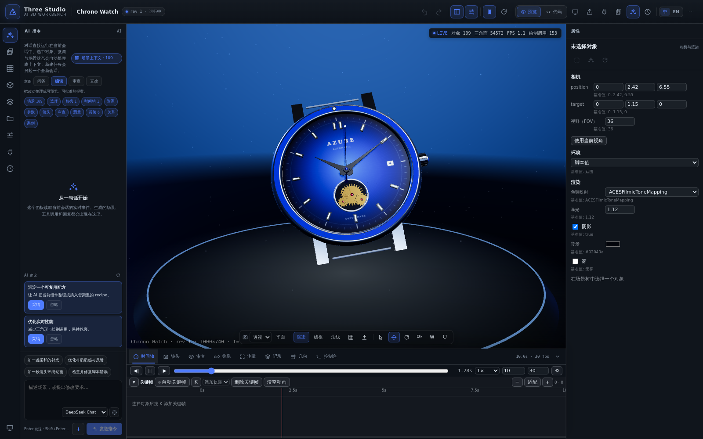
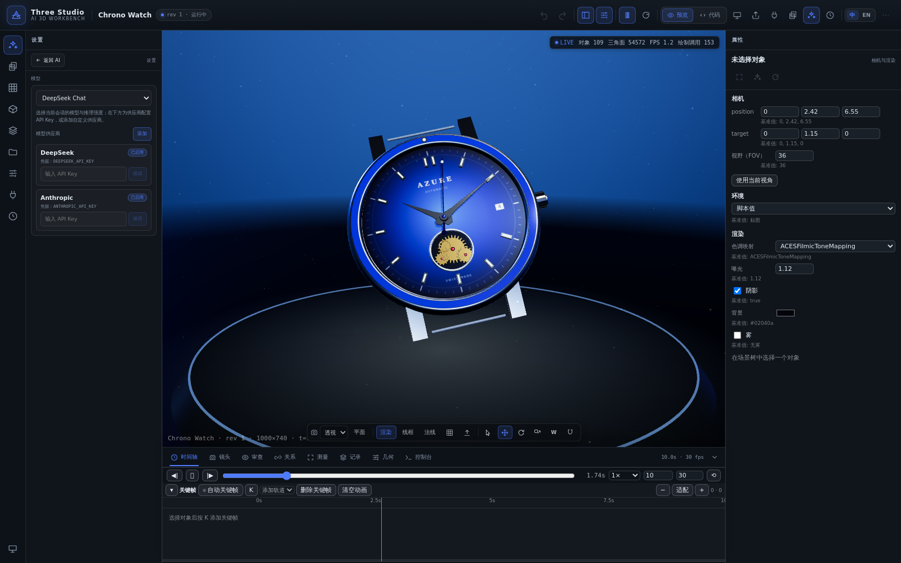
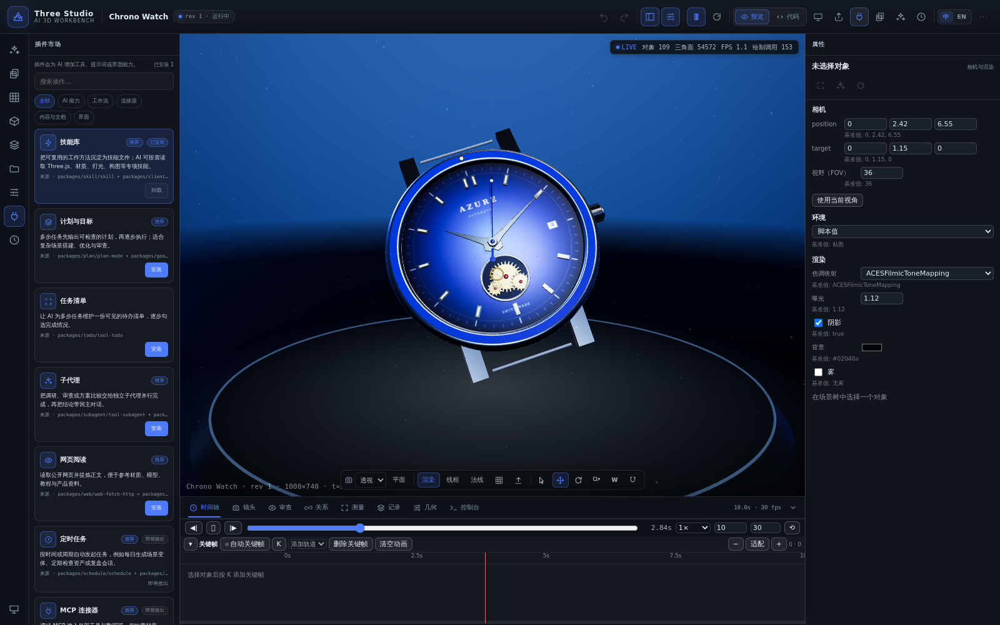
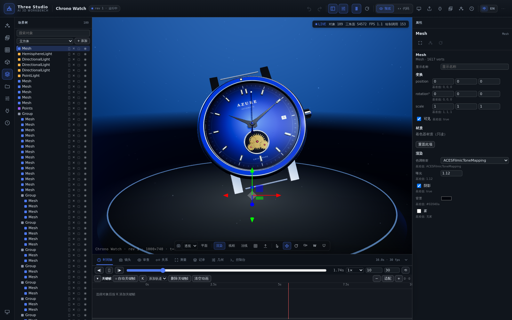
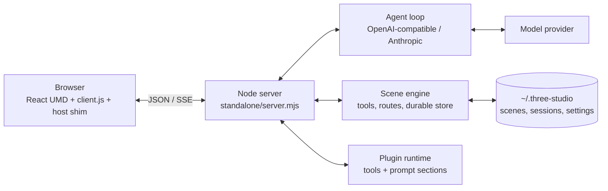

# Three Studio

**An AI-native 3D workbench for Three.js — standalone, local-first, and fully
embedded.**

Three Studio turns a conversation into a live 3D workspace. The AI writes
self-contained Three.js scenes through tools, the preview renders them in a
sandboxed `srcDoc` iframe, and the same surface carries an editor, timeline,
dope sheet, shots, review pins, measurements, assets, history, sessions, model
settings and a plugin market.

The primary deployment runs **without DeepSeek Harness**: its own Node server,
storage, agent loop and React shell. The original host-integrated Harness plugin
remains available as an optional legacy mode.

[English](README.md) · [简体中文](README.zh.md)



## Highlights

- **AI-native studio** — chat, streaming tool calls and scene revisions in the
  same surface as the viewport.
- **Real Three.js editing** — outliner, inspector, material/lighting controls,
  transform gizmos, parameters, timeline, keyframes, dope sheet, shots, review
  pins, measurements and deterministic exports.
- **Sandboxed execution** — model-written code runs only inside an opaque-origin
  `srcDoc` iframe (`allow-scripts allow-pointer-lock allow-downloads`, never
  `allow-same-origin`, never navigable).
- **Bring your own model** — DeepSeek and Anthropic are built in; add any
  OpenAI-compatible or Anthropic-compatible provider with its own API key, base
  URL and model list.
- **Plugin market** — install native Studio modules such as skills, planning,
  todo, subagents and web reading; more capabilities are listed on the roadmap.
- **Light and dark themes** — the standalone header has a one-click sun/moon
  toggle; the editor chrome and the default viewport background follow it, and
  the choice is persisted locally. A scene that explicitly sets its own
  background keeps that authored look.
- **Local-first data** — sessions, scenes, settings and credentials live under
  `~/.three-studio`; the server binds loopback only and sends no telemetry.
- **No Harness at runtime** — `standalone/server.mjs` depends only on Node 24 and
  the repository's own code plus vendored Three.js and React.

## Screenshots

| Model settings | Plugin market |
| --- | --- |
|  |  |



Screenshots use the Chrono Watch example (`examples/scene-watch.js`). Use the
**Sessions** tab to switch sessions and the header clock to browse revision
history.

## Quick start

Requirements: **Node.js 24+** and a modern browser. No package install is needed
for the standalone Studio; React and Three.js are vendored.

```sh
git clone <repository-url> three-studio
cd three-studio
./standalone/start.sh
# open http://127.0.0.1:3090/
```

To use a different port or data directory:

```sh
THREE_STUDIO_PORT=4000 THREE_STUDIO_HOME=/path/to/data ./standalone/start.sh
```

### Configure a model

1. Open the AI Prompt → gear at the bottom-right of the composer.
2. Enter an API key for **DeepSeek** or **Anthropic**, or choose **Add** to
   create a custom provider (provider id, base URL, protocol and model ids).
3. Pick the provider/model and reasoning effort from the composer.

Keys are stored in `~/.three-studio/credentials.json` with mode `0600`; provider
settings live in `~/.three-studio/models.json`. Nothing is uploaded anywhere
except the requests sent to the provider you configure.

### Install a plugin

Open **Plugin market** in the left rail or the plug icon in the header. Five
native modules are installable now:

| Plugin | What it adds |
| --- | --- |
| **Skills library** | `read_skill` over `~/.three-studio/skills/*.md`; seeded with a Three.js scene skill |
| **Planning and goals** | `write_plan` and plan-first prompt guidance |
| **Todo checklist** | `todo_write` for visible multi-step progress |
| **Subagents** | One-shot `spawn_subagent` research/review using the current model |
| **Web reader** | `web_fetch` with private/loopback address refusal and bounded output |

Installing activates tools immediately; uninstalling removes them. The market
also lists scheduled tasks, MCP connectors, web search, deliverables, file and
document panes, browser automation, background jobs, memory, hooks and voice
input as roadmap entries. See [`docs/PLUGINS.md`](docs/PLUGINS.md) and
[`standalone/plugins/RESEARCH.md`](standalone/plugins/RESEARCH.md).

## Architecture



- **Browser**: the existing Studio UI (`client.js`) rendered as the whole page by
  a small host shim (`standalone/public/boot.js`). No Cordis/Harness runtime.
- **Server**: HTTP static assets, session/model/plugin APIs and SSE streaming.
- **Scene engine**: the workbench's own `index.js` tools and routes, driven by a
  tiny Cordis-compatible context.
- **Agent**: provider-neutral history, streaming text, tool calls, `three_scene`
  and `workbench_proposal`.
- **Storage**: local files under `~/.three-studio`.

See [`docs/ARCHITECTURE.md`](docs/ARCHITECTURE.md) for the component contracts,
[`docs/PROTOCOL.md`](docs/PROTOCOL.md) for the scene/editor protocol, and
[`standalone/README.md`](standalone/README.md) for deployment details.

## Documentation

- [Architecture](docs/ARCHITECTURE.md)
- [Models and providers](docs/MODELS.md)
- [Plugins and marketplace](docs/PLUGINS.md)
- [Security and trust boundaries](docs/SECURITY.md)
- [Development and testing](docs/DEVELOPMENT.md)
- [Scene/editor protocol](docs/PROTOCOL.md)
- [IP provenance audit](docs/IP-PROVENANCE-AUDIT.md)
- [Optional Harness plugin mode](docs/HARNESS-PLUGIN.md)
- [Contributing](CONTRIBUTING.md)
- [Changelog](CHANGELOG.md)
- [Third-party notices](THIRD_PARTY_NOTICES.md)

## Development

The unit suite runs on Node 24 and uses no external test framework:

```sh
~/.local/node24/bin/node --test \
  tests/assets.test.mjs tests/behavior.test.mjs tests/export.test.mjs \
  tests/history.test.mjs tests/share.test.mjs tests/smoke.test.mjs \
  tests/studio-ai.test.mjs tests/tracks.test.mjs
~/.local/node24/bin/node --test standalone/plugins/runtime.test.mjs
```

`tests/disk.test.mjs` is excluded from local runs because its disk-lock probes
hang in this WSL environment; CI/owners should run it on a native filesystem.
See [`docs/DEVELOPMENT.md`](docs/DEVELOPMENT.md) for layout, screenshot capture
and troubleshooting.

## Optional Harness plugin mode

The historical host-integrated build lives at `index.js` + `client.js` and is
launched with `./start.sh` against a DeepSeek Harness checkout. It is documented
in [`docs/HARNESS-PLUGIN.md`](docs/HARNESS-PLUGIN.md) and is **not required** for
the standalone Studio.

## License

This repository is **not open source at this time**. No license is granted; all
rights are reserved. The source is published for viewing and evaluation only.
Third-party components keep their own licenses; see
[`THIRD_PARTY_NOTICES.md`](THIRD_PARTY_NOTICES.md).
