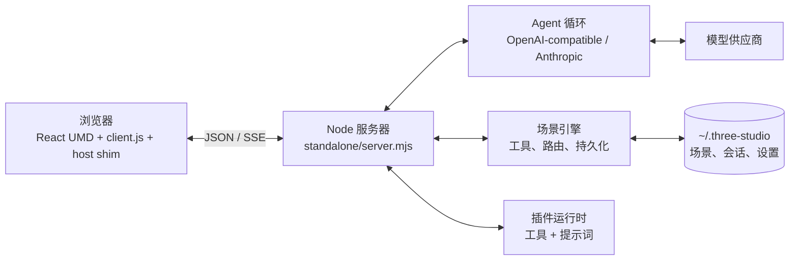

# Three Studio

**AI 原生的 Three.js 3D 工作台：独立部署、本地优先、完整嵌入式体验。**

Three Studio 把对话变成实时 3D 工作区。AI 通过工具编写自包含的 Three.js
场景，预览在沙箱 `srcDoc` iframe 中运行；同一界面还包含编辑器、时间轴、
Dope Sheet、镜头、审查标记、测量、资产、历史、会话、模型设置和插件市场。

主部署方式**不依赖 DeepSeek Harness**：自带 Node 服务器、存储、Agent 循环和
React 外壳。原 Harness 插件模式作为可选旧版保留。

[English](README.md) · [简体中文](README.zh.md)


## 主要能力

- **AI 原生工作台**：对话、流式工具调用和场景版本与视口在同一界面
- **真实 3D 编辑**：场景树、属性、材质/灯光、变换手柄、参数、时间轴、关键帧、
  Dope Sheet、镜头、审查、测量和确定性导出
- **沙箱执行**：模型代码仅在 opaque-origin `srcDoc` iframe 中运行
  （`allow-scripts allow-pointer-lock allow-downloads`，绝不 `allow-same-origin`，
  不可作为 URL 导航）
- **自带模型**：内置 DeepSeek / Anthropic；可添加、编辑或删除任意 OpenAI 兼容或
  Anthropic 兼容供应商，填写 Base URL、模型列表和 API Key
- **插件市场**：可安装技能库、计划、任务清单、子代理、网页阅读；更多能力在路线图中
- **浅色 / 深色主题**：独立版顶部提供太阳/月亮一键切换，界面与默认视口背景同步切换，选择会本地持久化；场景代码显式设置的背景会保留作者效果
- **本地数据**：会话、场景、设置和凭据保存在 `~/.three-studio`；只监听回环地址，
  不上报遥测
- **运行时不依赖 Harness**：只依赖 Node 24、仓库自身代码以及内置的 Three.js、React

## 截图

| 模型设置 | 插件市场 |
| --- | --- |
|  |  |


截图使用 Chrono Watch 示例场景（`examples/scene-watch.js`）。通过 **会话** tab
切换会话，通过顶部时钟回放版本历史。

## 快速开始

需要 **Node.js 24+** 和现代浏览器；独立版无需 `npm install`，React 与
Three.js 已内置。

```sh
git clone <repository-url> three-studio
cd three-studio
./standalone/start.sh
# 打开 http://127.0.0.1:3090/
```

自定义端口或数据目录：

```sh
THREE_STUDIO_PORT=4000 THREE_STUDIO_HOME=/path/to/data ./standalone/start.sh
```

### 配置模型

1. 打开 AI Prompt → 输入框右下角齿轮
2. 填入 **DeepSeek** 或 **Anthropic** 的 API Key；或点 **添加** 创建自定义供应商
   （供应商标识、Base URL、协议、模型 ID）
3. 在输入框右下角选择模型与推理强度

API Key 存于 `~/.three-studio/credentials.json`（0600）；供应商配置存于
`~/.three-studio/models.json`。除发送给你配置的模型供应商外，不上传任何数据。

### 安装插件

打开左侧栏 **插件市场** 或顶部插头图标。当前可直接安装：

| 插件 | 能力 |
| --- | --- |
| **技能库** | 通过 `read_skill` 读取 `~/.three-studio/skills/*.md`，内置 Three.js 场景技能 |
| **计划与目标** | `write_plan` 与计划优先提示词 |
| **任务清单** | `todo_write` 可见多步进度 |
| **子代理** | 一次性 `spawn_subagent` 调研/审查 |
| **网页阅读** | `web_fetch`，拒绝私网/回环地址并限制输出长度 |

安装后立即向 Agent 注入工具；卸载会移除。市场还列出定时任务、MCP 连接器、
网页搜索、交付与变更、文件/文档面板、浏览器自动化、后台任务、项目记忆、
自动化钩子和语音输入等路线图条目。

## 架构



- **浏览器**：现有 Studio UI（`client.js`）由宿主 shim 直接挂载为整页
- **服务器**：静态资源、会话/模型/插件 API 与 SSE 流
- **场景引擎**：工作台自己的 `index.js` 工具与路由
- **Agent**：供应商中立历史、流式文本、工具调用、`three_scene` 与 `workbench_proposal`
- **存储**：`~/.three-studio` 本地文件

详见 [架构文档](docs/ARCHITECTURE.md)、[场景协议](docs/PROTOCOL.md) 和
[独立部署说明](standalone/README.md)。

## 文档

- [架构](docs/ARCHITECTURE.md)
- [模型与供应商](docs/MODELS.md)
- [插件与市场](docs/PLUGINS.md)
- [安全与信任边界](docs/SECURITY.md)
- [开发与测试](docs/DEVELOPMENT.md)
- [场景/编辑器协议](docs/PROTOCOL.md)
- [IP 来源审计](docs/IP-PROVENANCE-AUDIT.md)
- [可选 Harness 插件模式](docs/HARNESS-PLUGIN.md)
- [贡献指南](CONTRIBUTING.md)
- [更新日志](CHANGELOG.md)
- [第三方声明](THIRD_PARTY_NOTICES.md)

## 开发

```sh
~/.local/node24/bin/node --test \
  tests/assets.test.mjs tests/behavior.test.mjs tests/export.test.mjs \
  tests/history.test.mjs tests/share.test.mjs tests/smoke.test.mjs \
  tests/studio-ai.test.mjs tests/tracks.test.mjs
~/.local/node24/bin/node --test standalone/plugins/runtime.test.mjs
```

`tests/disk.test.mjs` 的磁盘锁探针在当前 WSL 环境会挂起，本地运行默认排除；
应在原生文件系统或 CI 中运行。详见 [开发文档](docs/DEVELOPMENT.md)。

## 可选的 Harness 插件模式

历史 Host 集成版本由 `index.js` + `client.js` 组成，通过 `./start.sh` 对
DeepSeek Harness checkout 启动，见 [Harness 插件文档](docs/HARNESS-PLUGIN.md)。
独立 Studio 不需要它。

## 许可证

本仓库**当前未开源**，不授予任何许可证，保留所有权利。代码公开仅供查看与评估。
第三方组件遵循各自许可证，见 [THIRD_PARTY_NOTICES.md](THIRD_PARTY_NOTICES.md)。
