# Three Studio

**AI 原生的 Three.js 3D 工作台：独立部署、本地优先、完整嵌入式体验。**

Three Studio 把对话变成实时 3D 工作区。AI 通过工具编写自包含的 Three.js
场景，预览在沙箱 `srcDoc` iframe 中运行；同一界面还包含编辑器、时间轴、
Dope Sheet、镜头、审查标记、测量、资产、历史、会话、模型设置和插件市场。

主部署方式**不依赖 DeepSeek Harness**：自带 Node 服务器、存储、Agent 循环和
React 外壳。原 Harness 插件模式作为可选旧版保留。

[English](README.md) · [简体中文](README.zh.md)

**在线 Demo：** <https://mrw7.github.io/three-studio/> —— 十一个可直接运行的
Three.js demo：两段一分钟动画短片（ONE MINUTE 与《点灯人》）、涡扇发动机数字说明书、
agency 互动页、产品配置器、教育工作坊、动效、音频/数据可视化与空间漫游。

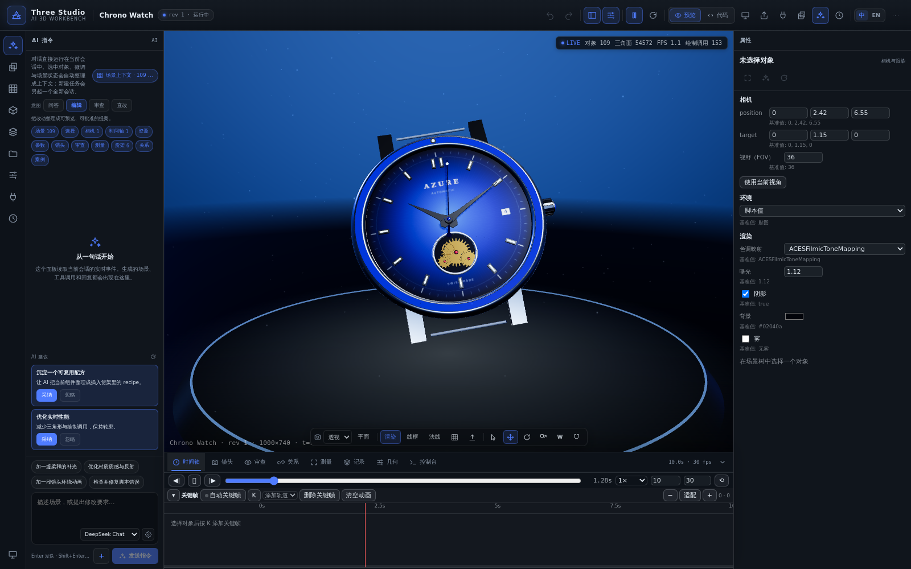

## 主要能力

- **AI 原生工作台**：对话、流式工具调用和场景版本与视口在同一界面
- **真实 3D 编辑**：场景树、属性、材质/灯光、变换手柄、参数、时间轴、关键帧、
  Dope Sheet、镜头、审查、测量和确定性导出
- **多目标导出**：PNG、确定性 MP4/GIF 与实时 WebM、动画或静态 glTF（`.glb`）、STL、OBJ、
  项目 ZIP 与独立 HTML；另含面向 AR 预览的 USDZ 与自研二进制 FBX 7.4 写出器。
  USDZ/FBX 为静态导出：保留几何、层级、变换、Phong 化材质、法线与一套 UV；
  动画、蒙皮、贴图、PBR 通道与顶点色不随行（FBX 以米为单位，`UnitScaleFactor=100`，
  与 Blender 米制输出一致）
- **一份场景，两种交付**：把机位/选择、BOM 和热点记录为交互说明书；按顺序编排影片
  镜头，支持缓动机位、安全框、SRT 字幕和本地音乐轨；导出 1080p/4K
  16:9/9:16/1:1/4:5 MP4（不回退实时 WebM）或批量导出全部四种画幅；分享只读
  说明书，支持打印到 PDF 和 QR 码。AI 可把说明书步骤作为可审核提案草拟出来。
- **沙箱执行**：模型代码仅在 opaque-origin `srcDoc` iframe 中运行
  （`allow-scripts allow-pointer-lock allow-downloads`，绝不 `allow-same-origin`，
  不可作为 URL 导航）
- **自带模型**：内置 DeepSeek；可添加、编辑或删除任意 OpenAI 兼容或
  Anthropic 兼容供应商，填写 Base URL、模型列表和 API Key，并可在设置中先测试连接
- **会话生命周期**：归档、恢复或删除旧会话；对话历史按完整轮次压缩并原子保存，长期使用不会无限增长
- **插件市场**：二十个原生模块一键安装：技能库、计划、任务清单、子代理、网页阅读与搜索、
  深度研究、项目记忆、项目上下文、操作卡片、交付文件、语音输入、工作区文件浏览与文档预览、
  后台任务、定时任务、自动化钩子、MCP 连接器、浏览器自动化与沙箱网页面板；
  信任面（MCP、浏览器控制）一律由用户手写配置开启
- **浅色 / 深色主题**：独立版顶部提供太阳/月亮一键切换，界面与默认视口背景同步切换，选择会本地持久化；场景代码显式设置的背景会保留作者效果
- **本地数据**：会话、场景、设置和凭据保存在 `~/.three-studio`；只监听回环地址，
  不上报遥测。Linux 使用崩溃安全的 fd 存储；macOS/Windows 使用可移植的原子
  快照存储保存场景、历史版本、资产、分享链接与缩略图，重启不再丢失作品。
- **运行时不依赖 Harness**：只依赖 Node 24、仓库自身代码以及内置的 Three.js、React

## 截图

| 模型设置 | 插件市场 |
| --- | --- |
| 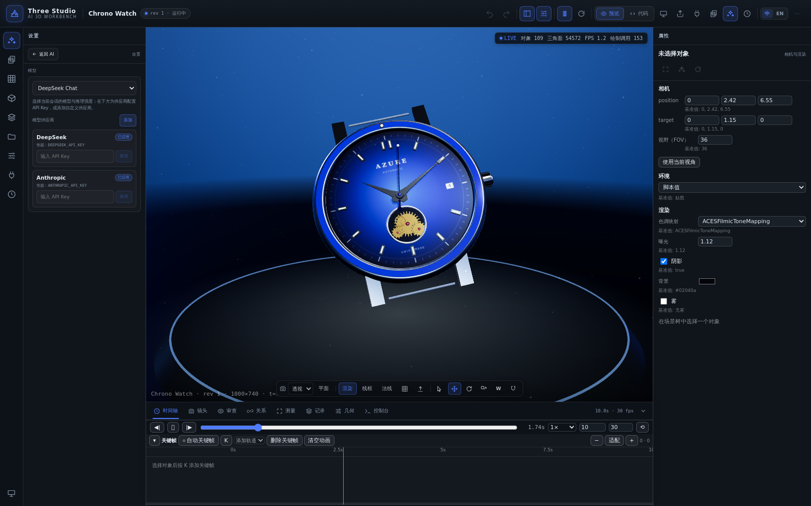 | 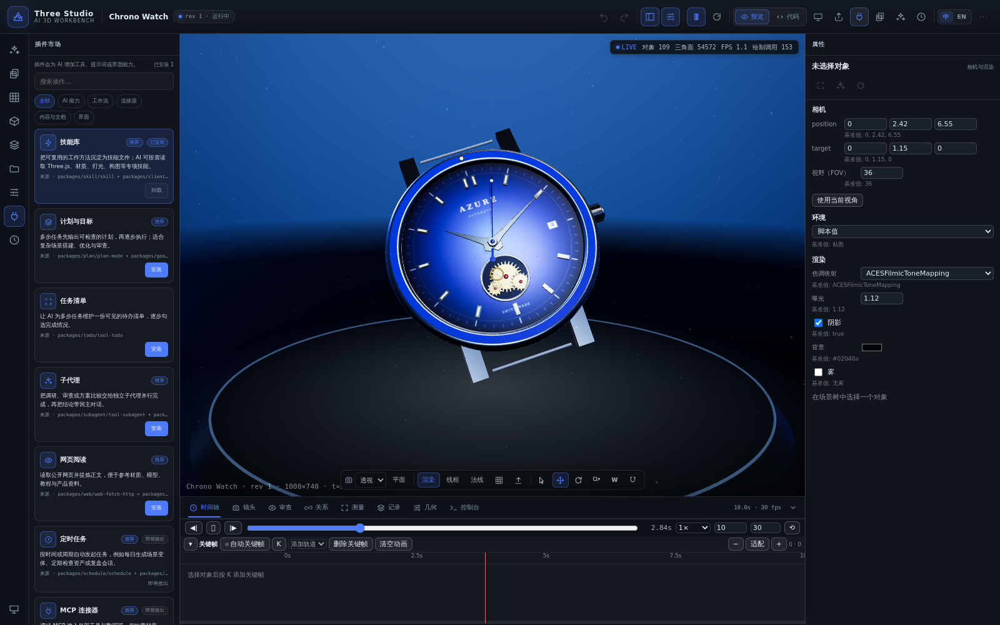 |

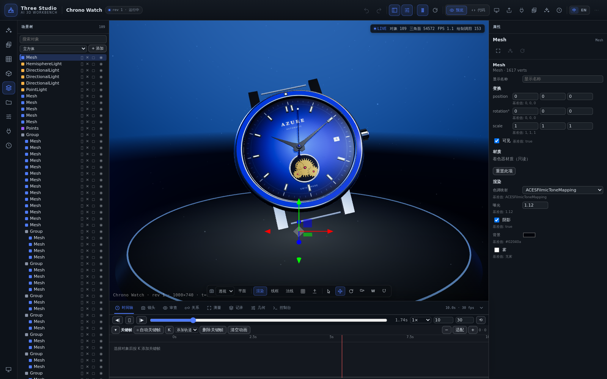

| 桌面窗口（Windows） |
| --- |
| 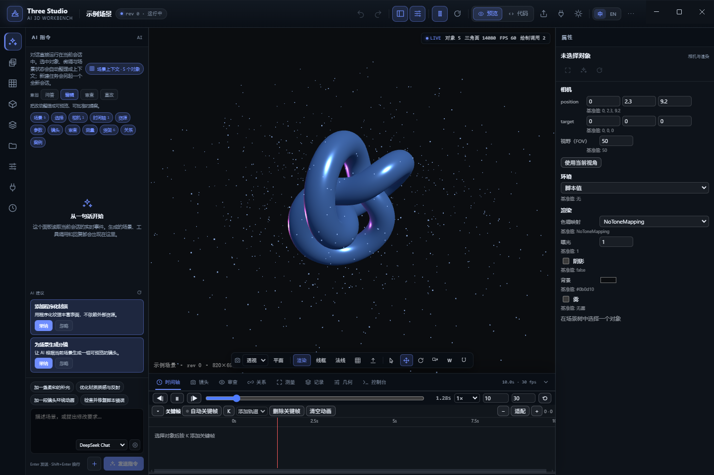 |

截图使用 Chrono Watch 示例场景（`examples/scene-watch.js`）。通过 **会话** tab
切换会话，通过顶部时钟回放版本历史。

## Demo

`examples/` 里有两件完整作品：沙箱场景脚本 + 产品内容 JSON，全部离线运行、
不依赖任何外部资源。

### 涡扇发动机说明书

按公开的高涵道比发动机比例与 NASA Glenn 涡扇原理描述程序化建模：封闭进气唇口
配吸音层、22 片宽弦风扇叶片（NACA 翼型，叶根 58° 到叶尖 27° 的扭转）、44 片
出口导流叶片、三级增压级、八级高压压气机（转子转动、静子固定）、20 个喷油嘴的
环形燃烧室、两级高压涡轮 + 五级低压涡轮、核心尾喷管与中心锥、机翼吊挂。短舱与
核心机罩做剖切以露出内部模块，双转子以不同转速旋转（N2 ≈ 1.63 × N1）。配一份
八步交互说明书：七项 BOM 零件、每步独立机位、可隐藏部件、可高亮对象与热点。

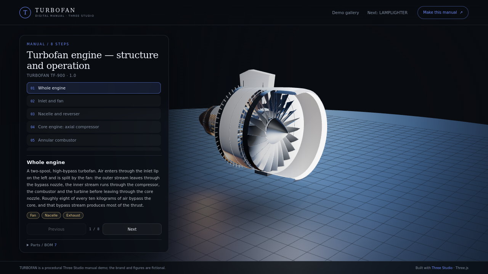

```sh
examples/scene-engine.js        # 场景
examples/turbofan-manual.json   # 8 步、7 项 BOM、热点
```

### 《点灯人》The Lamplighter

60 秒十镜短片：一个靠胸口灯泡活着的小机器人，在雾夜的街道上跋涉、爬灯柱、
失手坠落、再爬上去，把自己胸口的灯拧进灯座——然后熄灭，让整条街亮起来。
十次硬切、程序化步态、攀爬中段的坠落与镜头震动、两次将熄的闪烁、逐盏传递的
街灯与最后的标题卡。

| 涉水前行（第 2 镜） | 坠落（第 5 镜） |
| --- | --- |
| 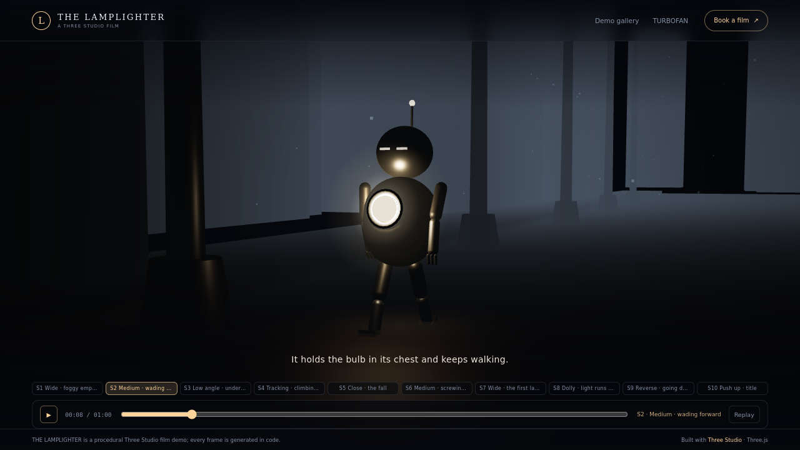 | 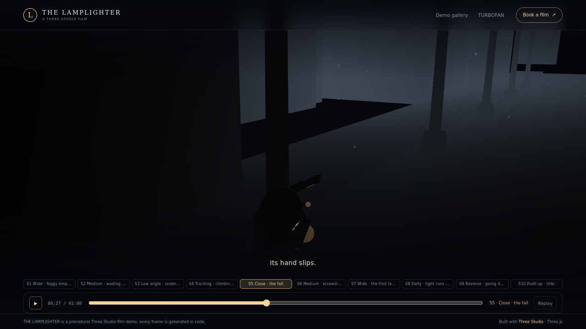 |

| 第一盏灯（第 7 镜） | 标题（第 10 镜） |
| --- | --- |
| 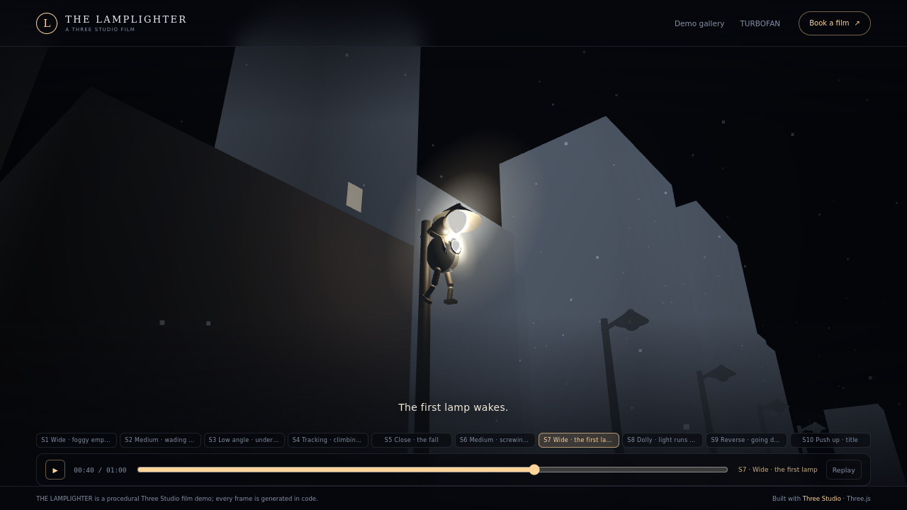 | 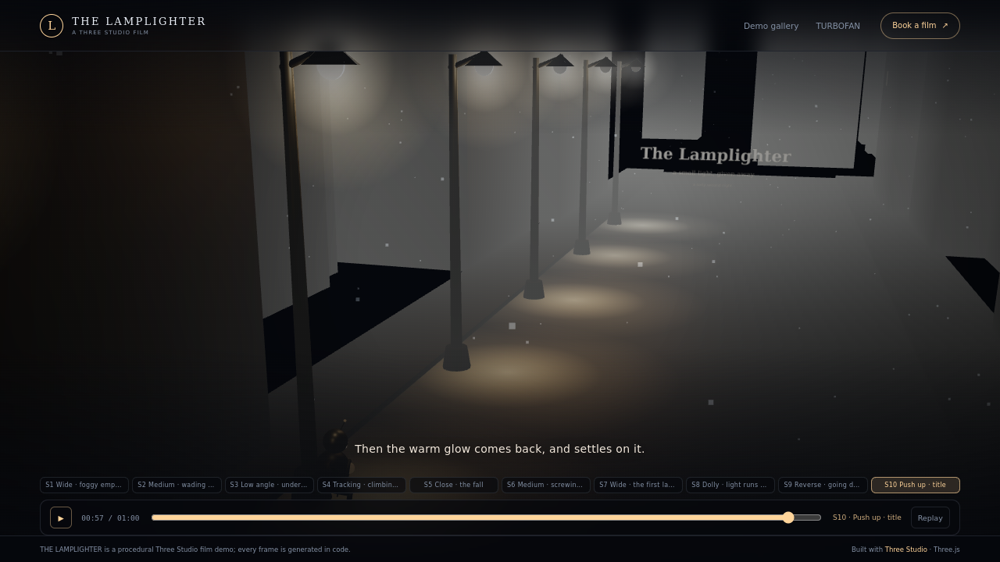 |

```sh
examples/scene-lamplighter.js   # 场景，10 个硬切镜头
examples/lamplighter-film.json  # 影片设置 + 10 条 SRT 字幕
```

两者都由 `tests/examples.test.mjs` 校验：说明书能通过 Host 侧
`workbench_proposal` 校验，引用的每个 UID 都存在于场景中，场景脚本只使用
文档允许的沙箱全局。每个镜头的实现细节见
[`examples/README.md`](examples/README.md)。

## 快速开始

需要 **Node.js 24+** 和现代浏览器；独立版无需 `npm install`，React 与
Three.js 已内置。

```sh
git clone <repository-url> three-studio
cd three-studio
./standalone/start.sh
# 打开 http://127.0.0.1:3090/
```

自定义端口或数据目录：

```sh
THREE_STUDIO_PORT=4000 THREE_STUDIO_HOME=/path/to/data ./standalone/start.sh
```

### 桌面 alpha

`desktop/` 用未签名的 Electron 窗口包装同一服务器，数据存放在系统应用数据
目录；需要 `PATH` 上有 Node 24（或设置 `THREE_STUDIO_NODE`），见
[`desktop/README.md`](desktop/README.md)。

### 把 Linux 磁盘存储迁移到 portable 后端

在 Linux 上运行，然后把生成的 `portable/` 目录复制到 macOS/Windows（或把
`THREE_WORKBENCH_DATA_DIR` 指向目标目录）：

```sh
node standalone/migrate-portable.mjs --from ~/.three-studio/scenes --to /path/to/target
```

`--to` 默认与 `--from` 相同，源磁盘数据不会被删除。目标已有 portable
manifest 时默认拒绝覆盖，除非传 `--force`。

### 合并另一个 portable 存储

把另一个 portable 存储中的场景、资产、分享与缩略图合并到当前存储（源只读，
目标会被重写）：

```sh
node standalone/merge-portable.mjs --from /path/to/source --to /path/to/target
node standalone/merge-portable.mjs --from /path/to/source --to /path/to/target --on-conflict replace
```

默认 `skip`：目标已有同 id 的场景/资产/分享/缩略图时保留目标；`replace` 则覆盖
同 id 记录。同一 Session 下同名资产始终跳过。若场景 Session id 冲突，`skip`
模式会同时跳过该 Session 的资产、缩略图和分享。执行 `replace` 前建议先复制
目标的 `portable/` 目录。

### 合并会话与供应商设置

场景数据和 profile 的其他文件是分开的。先停止两个 Studio 服务器，再合并会话
与非密钥型供应商设置：

```sh
node standalone/profile-merge.mjs --from /path/to/source-home --to /path/to/target-home
node standalone/profile-merge.mjs --from /path/to/source-home --to /path/to/target-home --on-conflict replace
```

- 合并 `sessions.json` 与 `models.json`；同 id 的会话/供应商默认跳过，
  `--on-conflict replace` 覆盖。
- **绝不复制 `credentials.json`**，请在新机器上重新填写 API Key。
- 写入前会在目标文件旁生成带时间戳的 `.bak-*` 备份。
- `--dry-run` 只校验并报告，不写文件。
- 源 home 可以来自 Linux/macOS/Windows，此工具与平台无关。

### 配置模型

1. 打开 AI Prompt → 输入框右下角齿轮
2. 填入 **DeepSeek** 的 API Key；或点 **添加** 创建自定义供应商
   （供应商标识、Base URL、协议、模型 ID）
3. 点击 **测试连接**，先验证 API Key 和第一个模型
4. 在输入框右下角选择模型与推理强度

API Key 存于 `~/.three-studio/credentials.json`（0600）；供应商配置存于
`~/.three-studio/models.json`。除发送给你配置的模型供应商外，不上传任何数据。

### 安装插件

打开左侧栏 **插件市场** 或顶部插头图标。二十个原生模块均可一键安装：

| 领域 | 插件 |
| --- | --- |
| Agent 上下文 | 技能库、计划、任务清单、项目记忆、项目上下文（含 `AGENTS.md` 注入） |
| 研究与网页 | 子代理、网页阅读（`web_fetch`）、网页搜索、深度研究 |
| Studio 工作区 | 交付文件、文件浏览、文档预览、操作卡片、语音输入 |
| 自动化 | 后台任务、定时任务、自动化钩子 |
| 连接器（需用户配置） | MCP 连接器、CDP 浏览器自动化、沙箱网页面板 |

安装后立即向 Agent 注入工具；卸载会移除。信任面一律由用户手写配置文件
开启：MCP 与浏览器自动化在配置文件不存在时会拒绝安装并给出指引。
各插件的工具、限制与配置见 [插件文档](docs/PLUGINS.zh.md)，信任模型见
[插件信任边界](docs/TRUST-BOUNDARIES.zh.md)。

## 架构

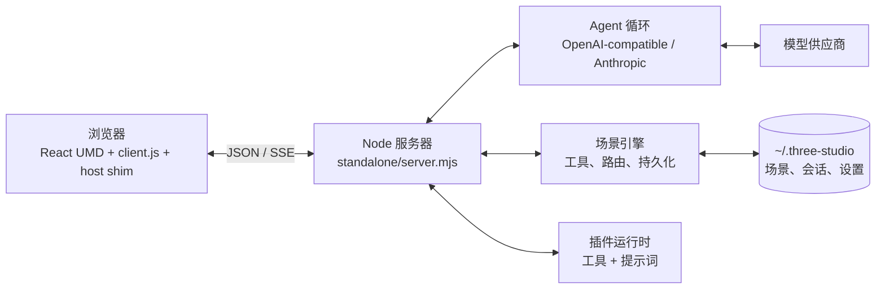

- **浏览器**：现有 Studio UI（`client.js`）由宿主 shim 直接挂载为整页
- **服务器**：静态资源、会话/模型/插件 API 与 SSE 流
- **场景引擎**：工作台自己的 `index.js` 工具与路由
- **Agent**：供应商中立历史、流式文本、工具调用、`three_scene` 与 `workbench_proposal`
- **存储**：`~/.three-studio` 本地文件

详见 [架构文档](docs/ARCHITECTURE.md)、[场景协议](docs/PROTOCOL.md) 和
[独立部署说明](standalone/README.md)。

## 文档

- [架构](docs/ARCHITECTURE.md)
- [开源核心边界](docs/OPEN-CORE.zh.md)（[English](docs/OPEN-CORE.md)）
- [模型与供应商](docs/MODELS.md)
- [导出](docs/EXPORTS.zh.md)（[English](docs/EXPORTS.md)）
- [说明书与影片](docs/MANUAL-FILM.zh.md)（[English](docs/MANUAL-FILM.md)）— 说明书步骤、影片导出与开源/Pro 边界
- [插件与市场](docs/PLUGINS.zh.md)（[English](docs/PLUGINS.md)）
- [安全与信任边界](docs/SECURITY.zh.md)
- [隐私说明](PRIVACY.md)（[English](docs/SECURITY.md)）
- [插件信任边界](docs/TRUST-BOUNDARIES.zh.md)（[English](docs/TRUST-BOUNDARIES.md)）
- [插件配置示例](examples/plugin-config/README.zh.md)
- [桌面 alpha](desktop/README.md)
- [Demo gallery](https://mrw7.github.io/three-studio/)（[源码](site/index.html)、[ONE MINUTE](site/one-minute-demo/README.md)、《[点灯人](site/lamplighter-demo/README.md)》、[发动机说明书](site/engine-demo/README.md)、[agency](site/agency-demo/README.md)、[配置器](site/configurator-demo/README.md)、[教育](site/education-demo/README.md)、[动效](site/README.md)、[数据/空间](site/README.md)）
- [开发与测试](docs/DEVELOPMENT.md)
- [场景/编辑器协议](docs/PROTOCOL.md)
- [可选 Harness 插件模式](docs/HARNESS-PLUGIN.md)
- [路线图](ROADMAP.md)
- [贡献指南](CONTRIBUTING.md)（[DCO](DCO)）
- [治理](GOVERNANCE.md)
- [行为准则](CODE_OF_CONDUCT.md)
- [隐私说明](PRIVACY.md)
- [商标政策](TRADEMARK.md)
- [更新日志](CHANGELOG.md)
- [第三方声明](THIRD_PARTY_NOTICES.md)

## 开发

```sh
npm test        # 单元、协议与回环 API 安全回归
```

浏览器探针（临时 home + 本地 mock 网关，各用独立端口）：

```sh
npm run test:e2e:standalone   # 移动端/会话/连接测试/取消后再发
npm run test:e2e:exports      # 真实导出菜单捕获 USDZ 与 FBX
npm run test:e2e:plugins      # 操作卡/交付卡/语音按钮/Files 面板/网页面板
```

`tests/disk.test.mjs` 的磁盘锁探针在当前 WSL 环境会挂起，本地运行默认排除；
应在原生文件系统或 CI 中运行。详见 [开发文档](docs/DEVELOPMENT.md)。

## 限制

- **USDZ / FBX 为静态导出**：保留几何、层级、局部变换、法线、一套 UV 与
  Phong 化材质；动画、蒙皮、贴图、PBR 通道与顶点色不随行。FBX 名称会转写为
  可打印 ASCII，单位为米（`UnitScaleFactor=100`）。USDZ 经 three 导出器保留
  贴图，面向 AR Quick Look。详见 [导出文档](docs/EXPORTS.zh.md)。
- **网页面板**：无法显示发送 `X-Frame-Options`/CSP frame-ancestors 的站点，
  并拒绝私网与环回主机；面板与 Studio 不共享 Cookie 或存储。
- **网页搜索**默认使用免费的 DuckDuckGo HTML 端点，可能限流或改版；正式使用
  可在 `~/.three-studio/search.json` 配置 Tavily/Brave 的 key。搜索只返回
  标题、URL 与摘要，正文仍需 `web_fetch`。
- **MCP** 仅支持 stdio 传输与 tools 能力（无 HTTP/SSE、sampling、roots）；
  服务器 stderr 一律丢弃，不回显。
- **定时任务**仅在独立服务器运行期间触发，且只作用于创建它的会话；卸载插件
  即停止。
- **语音输入**依赖浏览器 SpeechRecognition（Chromium 系与 Safari；Firefox 需
  开启开关），且仅在插件安装后显示按钮。
- **浏览器自动化**需要以 `--remote-debugging-port` 启动 Chrome 并手写
  `~/.three-studio/browser-automation.json`；Agent 无法自行开启。
- **插件信任配置**（`mcp.json`、`browser-automation.json`、`hooks.json`、
  `search.json`）刻意由用户手写：Agent 可读取状态，但没有任何写入这些文件的工具。
- **持久化范围**：Linux 的 fd 存储与 macOS/Windows 的可移植快照存储都保存
  场景、资产、分享、缩略图与历史版本。
- **桌面 alpha**：`desktop/` 是未签名的 Electron 壳，启动独立服务器；
  `npm start` 需要 `PATH` 上有 Node 24（或设置 `THREE_STUDIO_NODE`），
  `npm run dist` 会通过 `desktop/scripts/prepare-node.mjs` 捆绑 Node 24。
  代码签名、公证与自动更新尚未完成。
- **本地单用户范围**：服务器只监听回环地址且没有认证，请勿把端口暴露到
  不可信网络。浏览器发起的 API 写请求需要每进程 token 与同源 Fetch 元数据，
  但服务器不是多租户服务。

## 可选的 Harness 插件模式

历史 Host 集成版本由 `index.js` + `client.js` 组成，通过 `./start.sh` 对
DeepSeek Harness checkout 启动，见 [Harness 插件文档](docs/HARNESS-PLUGIN.md)。
独立 Studio 不需要它。

## 许可证

Three Studio 核心以 **Apache License 2.0** 开源，见 [`LICENSE`](LICENSE) 与
[`NOTICE`](NOTICE)。你可以使用、修改、分发并商业化，包括用于专有托管服务，
只需保留许可证与声明要求。

第三方组件遵循各自许可证，见 [THIRD_PARTY_NOTICES.md](THIRD_PARTY_NOTICES.md)。
“Three Studio”与“Three Workbench”是项目名称/商标，见
[`TRADEMARK.md`](TRADEMARK.md)。
