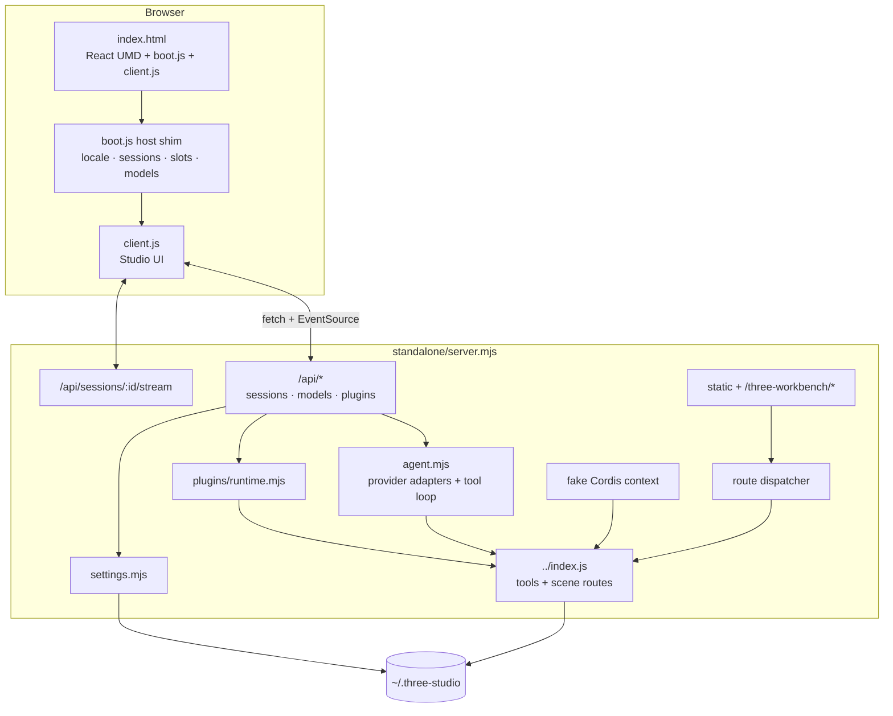

# Architecture

Three Studio ships two deployment shapes:

1. **Standalone (primary)** — `standalone/` runs the Studio without DeepSeek
   Harness. The Node server, agent loop, scene engine, data store and browser
   shell are all in this repository.
2. **Optional Harness plugin** — `index.js` + `client.js` loaded by a
   DeepSeek Harness host. See [HARNESS-PLUGIN.md](HARNESS-PLUGIN.md).

This document describes the standalone shape.

## Component map

## Browser shell

`standalone/public/index.html` loads the vendored React UMD bundles, `boot.js`
and the original `client.js` as classic scripts.

`boot.js` supplies the small host contract the Studio was written against:

- `window.__ModuleLoader__.load` registration facade
- `createSnapshotStore` compatible store
- locale dictionaries and `bind/getLocale/setLocale/subscribe`
- a session catalog and per-session `SessionFace`/`EventSource` shims
- slots, workspaces, layout and UI-workspace stubs
- `ctx.remote` backed by the local model/provider APIs
- `ctx.get('modelDirectories')` backed by the local model catalog

The workbench slot component is then mounted as the whole page. There is no
Host sidebar or host shell behind it; Studio is the application.

Product content is layered on the same editor state: the optional
`editorRecordV2.presentation` carries manual steps, BOM/hotspots, film shots,
SRT captions and music metadata; share snapshots include it, and the share
viewer reads a projection from
`/three-workbench/share/<id>/presentation`. The Film drawer renders an ordered
shot sequence (eased start→end camera per shot, hard cuts) through the existing
deterministic `capture-frame` protocol with an explicit 1080p/4K aspect plan
and an optional Opus audio track; it does not add a second renderer. The 4K
path moves `VideoEncoder` + `mp4-muxer` into a same-origin module worker that
receives transferred RGBA frames; 1080p keeps the in-line encoder. The share
viewer adds a read-only manual sidebar, BOM/hotspot lists, projected leader
lines, print-to-PDF and a local QR code. See [`MANUAL-FILM.md`](MANUAL-FILM.md).

## Server

`standalone/server.mjs`:

- serves `index.html`, `boot.js`, `client.js`, vendored React and the Three.js
  runtime routes
- exposes session, model/provider, plugin and SSE endpoints
- dispatches `/three-workbench/*` through the scene engine's registered routes
  (`resource` routes receive Web `Request` objects; `handler` routes receive
  Node `IncomingMessage`/`ServerResponse`)
- binds loopback only by default

## Scene engine

`index.js` is the workbench's own scene engine. It exposes:

- the `three_scene` tool (complete scene script → durable revision)
- the `workbench_proposal` tool (inert, reviewable proposals)
- scene state/restore/thumbnail/asset/share routes
- a Linux fd-anchored durable store, a portable macOS/Windows snapshot store
  (scenes, history and assets), and an in-memory fallback

The standalone server runs it through a tiny Cordis-compatible context that
implements only the surfaces `index.js` uses: `effect`, `tools.register`,
`systemPrompt.section`, `inject(['webServer'])` and `webServer.register`.

## Agent loop

`standalone/agent.mjs` is provider-neutral:

- canonical history: `user`, `assistant` (with tool calls), `tool` results
- adapters for OpenAI-compatible chat completions and Anthropic Messages
- streaming text and tool-call accumulation
- up to 8 tool rounds per prompt
- tool definitions come from the live scene/plugin registries
- scene tools execute against the same durable store as the UI

`server.mjs` maps each prompt to session events and SSE frames. The browser shim
reconstructs `SessionFace` and `EventSource` snapshots for the Studio transcript.

## Plugin runtime

`standalone/plugins/runtime.mjs` activates a plugin by adding tools, system
prompt sections, HTTP routes and event listeners to the live context;
uninstalling removes exactly those contributions (including timers, child
processes and CDP sockets). Installed ids persist in `plugins.json`.

Activators receive `pluginRoutes` for UI-facing routes (file-browser),
`subscribe('turn-end')` for completed-turn events (hooks) and
`submitPrompt(sessionId, text)`, which reuses the same `startAgentTurn` pipeline
as a manual prompt (scheduled tasks). All twenty catalog entries are
implementable native modules; trust surfaces (MCP and browser automation) are
user-configured and refuse to install without their config file.

The catalog (`catalog.mjs`) is metadata only. Available and roadmap entries are
distinguished by `available`. See [PLUGINS.md](PLUGINS.md).

## Storage

`THREE_STUDIO_HOME` defaults to `~/.three-studio`:

| File / dir | Contents |
| --- | --- |
| `models.json` | providers, endpoints, protocols, model ids |
| `credentials.json` | provider API keys (`0600`) |
| `sessions.json` | session metadata, event log, canonical history |
| `plugins.json` | installed plugin ids |
| `skills/` | flat `<name>.md` skills |
| `scenes/` | durable scene store used by `index.js` |
| `memory.json` | project memory entries (memory plugin) |
| `context/` | user-provided context files; `AGENTS.md` is injected |
| `deliverables/<session>/` | text deliverables from the agent |
| `schedules.json` | recurring prompts (scheduled-tasks plugin) |
| `hooks.json` | user-authored automation hooks |
| `search.json` | optional Tavily/Brave key (user-authored) |
| `mcp.json` | user-authored MCP stdio servers |
| `browser-automation.json` | user-authored CDP endpoint |
| `browser-captures/` | screenshots from browser automation |

`THREE_WORKBENCH_DATA_DIR` can point the scene store at an existing directory.

## Data flow

1. The browser sends a prompt (`POST /api/sessions/:id/prompt`) with text parts.
   Scheduled tasks enter the same `startAgentTurn` path without a browser.
2. The server appends a `user/message` event and starts the agent.
3. The agent streams `assistant/live-chunk` frames, then executes tool calls.
4. `three_scene` writes a durable revision; the UI polls/fetches the scene state
   and renders it in the sandboxed iframe.
5. Tool events carry presentation metadata (`revision`, `proposal`) so the
   transcript can render scene/proposal cards.
6. The server finishes with an assistant message and a state update.

## Non-goals

- No Harness runtime is bundled or required in standalone mode.
- No arbitrary plugin code executes in-process; the marketplace installs native
  modules only.
- The scene iframe is never same-origin with the application and never served
  as a navigable document.
- Multi-user accounts, remote collaboration and cloud persistence are out of
  scope for this build.
